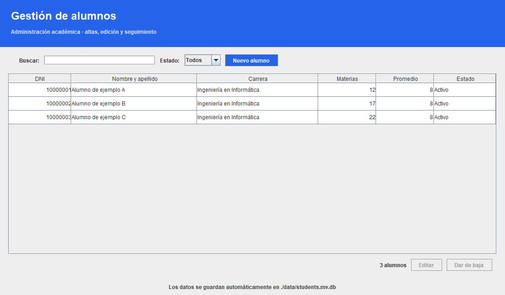

# Student Management Desktop



Aplicación Java de escritorio para administrar alumnos: altas, edición, búsqueda, seguimiento académico y bajas lógicas.

Este proyecto moderniza un trabajo original desarrollado en NetBeans durante la cursada de Programación. La edición actual consolida cinco subproyectos antiguos en una sola aplicación, elimina instaladores y dependencias manuales, corrige problemas de validación y ofrece persistencia embebida reproducible.

## Funcionalidades

- Alta y edición de alumnos.
- Validación de DNI, fechas, promedio y materias aprobadas.
- Búsqueda por nombre, DNI o carrera.
- Filtros por alumnos activos e inactivos.
- Baja lógica y reactivación.
- Ordenamiento desde la tabla.
- Base H2 local creada automáticamente.
- Configuración JDBC mediante variables de entorno.

## Tecnologías

- Java 25.
- Swing.
- JDBC.
- H2 Database.
- Maven.
- JUnit 5.

## Ejecutar

Requisito: JDK 25. El Maven Wrapper ya está incluido.

```bash
./mvnw clean package
java -jar target/student-management-desktop-1.0.0-SNAPSHOT.jar
```

En Windows:

```powershell
.\mvnw.cmd clean package
java -jar target\student-management-desktop-1.0.0-SNAPSHOT.jar
```

La base se crea automáticamente en `data/students.mv.db`. Esa carpeta está excluida de Git.

## Configuración de base

Por defecto se utiliza H2 en modo archivo. La conexión puede reemplazarse sin modificar código:

```text
STUDENT_DB_URL=jdbc:h2:file:./data/students
STUDENT_DB_USER=sa
STUDENT_DB_PASSWORD=
```

## Pruebas

```bash
./mvnw test
```

Las pruebas usan bases H2 en memoria independientes y cubren validaciones, CRUD, búsquedas, filtros y eliminación.

El JAR también ofrece una comprobación sin interfaz, útil para CI:

```bash
java -jar target/student-management-desktop-1.0.0-SNAPSHOT.jar --check
```

## Arquitectura

```text
domain/       modelo y reglas de validación
repository/   contrato de persistencia e implementación JDBC
service/      casos de uso y reglas de negocio
ui/           interfaz Swing y modelo de tabla
```

## Evolución respecto del original

- Un único proyecto Maven en lugar de cinco proyectos NetBeans enlazados por JAR.
- Fechas con `java.time` en lugar de una subclase de `GregorianCalendar`.
- Consultas preparadas y conexiones acotadas con `try-with-resources`.
- Base embebida sin necesidad de XAMPP, HeidiSQL ni credenciales locales.
- Validaciones de dominio reutilizables y pruebas automatizadas.
- Código y textos normalizados a UTF-8.

## Autor

Federico Pucci — [FedePucci1](https://github.com/FedePucci1)
